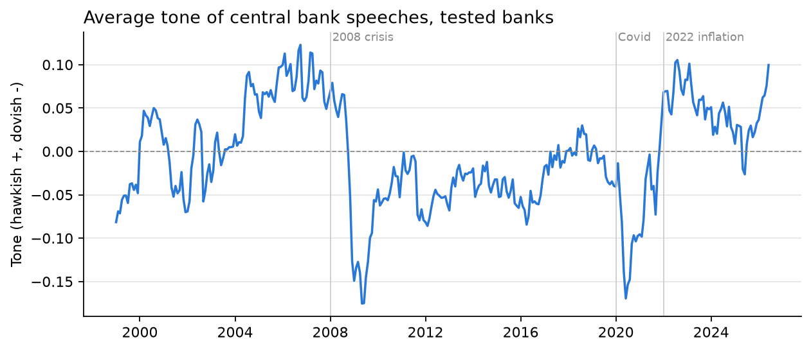
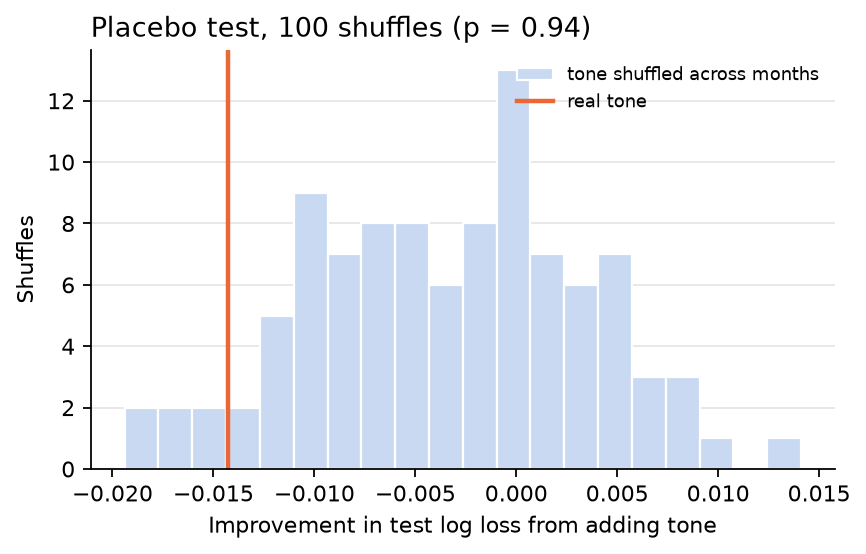

# What Are Central Banks Really Saying?

**Hawkish and dovish tone in 20,744 speeches by central bankers from 79 central
banks, 1996 to 2026: read by a language model, distilled into a free local
model, and tested against every policy rate decision of 21 central banks.**


Interest rates move every price in finance: bonds, stocks, currencies,
mortgages. Central bankers hint at where rates are going in their speeches,
weeks before they decide, and fund managers and analysts read those speeches
for the signal. There are hundreds a month, from dozens of central banks.
Research tools that score them exist for the US Federal Reserve. This project
scores **every central bank** in the BIS archive, measures how well that
scoring agrees with people, and asks whether the tone actually tells you
anything about the next rate decision.

## What it found

| Question | Answer |
|---|---|
| Can a cheap model read central bank tone? | Roughly as well as published systems. On 496 human-labeled Fed sentences, a zero-shot language model agreed with people **65.3%** of the time; the free local model trained on its labels **59.3%**. A published benchmark puts zero-shot ChatGPT at an F1 of 0.58 and a fine-tuned RoBERTa-large at 0.70. Outside the Fed, two models from different families agreed on **88.7%** of 150 sentences. |
| Does tone move with policy? | **Yes.** Tone over three months lines up with the rate change over the next three at **19 of 21** central banks (sign test p = 0.0002). Before hikes tone averages **+0.049**, before cuts **-0.031**. |
| Does tone lead, or follow? | **Mostly follows.** It tracks the rate moves already made (+0.23) and inflation (+0.25) as closely as the moves to come (+0.20). |
| Does tone predict next month's decision beyond past rates and inflation? | **No.** Adding tone made the chosen model slightly worse on 2020 to 2026 (log loss 0.524 to 0.539), and shuffling tone across months did as well as real tone (placebo **p = 0.94**). |

Full results: **[reports/FINDINGS.md](reports/FINDINGS.md)**.



The answer to the last question is a "no", and an informative one: speeches
describe the policy cycle, but a bank's own recent moves and the latest
inflation figure already carry that information by the time the next decision
comes.

## How it works

```
BIS speech archive (31 yearly files, 1996-2026)   five central banks' RSS feeds (newer speeches)
BIS policy rates (50 areas, daily)   BIS consumer prices (monthly)
      ↓  cbtone ingest    clean text, find each speaker's bank, split 2.29M sentences
      ↓                   keep 669,213 about policy, prices, rates or the economy
      ↓  cbtone label     a language model labels 8,001 sampled sentences (one-off, about 390,000 tokens)
      ↓  cbtone score     local embeddings + logistic regression score every sentence, free
      ↓  cbtone analyze   Q1-Q3 → results.json, figures, FINDINGS.md, the website's data
      ↓  cbtone update    add new speeches from the archive and live feeds, in seconds
```

### Reading tone without paying for every sentence

1. **An answer key from people.** The Trillion Dollar Words study labeled 2,480
   Federal Reserve sentences by hand. Its test file is used only for the final
   score, never for choosing a model or a prompt.
2. **A language model labels a sample.** DeepSeek V4.1 Flash, through any
   OpenAI-compatible endpoint, labels 8,001 policy sentences spread across
   every bank (each bank's share grows with the square root of its size). Three
   models were compared on the answer key's *training* file and the fastest
   equally accurate one kept.
3. **A local model learns from both.** Sentences are embedded with
   `BAAI/bge-small-en-v1.5` (64 MB, runs on a laptop CPU through ONNX) and
   classified by logistic regression, trained on the human and machine labels
   together. It was chosen over a TF-IDF baseline by cross-validation grouped by
   speech.
4. **A check outside the Fed.** No people have labeled other banks' speeches,
   so a second model from a different family (GLM 5.3) labeled the same 150
   sentences from 20 other central banks. The two agreed 88.7% of the time
   (Cohen's kappa 0.82). That is agreement between models, not accuracy, and
   the report says so.

Scoring all 669,213 sentences took 2 hours 16 minutes once; the language model
is never needed again, and a week of new speeches is scored in seconds.

### Testing whether tone predicts decisions

Every bank-month row holds only what was known by month end: tone from
speeches given by then, inflation lagged a month because prices are published
a month late. The target is the next month's decision (a move of 0.10 points
or more at month end). Models are trained on 1999 to 2016, chosen on 2017 to
2019 and tested once on 2020 onward, with and without tone. A placebo shuffles
each bank's tone across months 100 times, because any extra column lets a
model fit some noise.



## The website

A static **Next.js** site reads JSON exported by the pipeline, so every chart
loads with no server; only "Score a speech" calls a small **FastAPI** service
running the same local model.

- **Overview:** the headline numbers, the average tone across central banks
  over 30 years, what a tone score means, which banks sound most hawkish now,
  and the four steps from raw speeches to the answer.
- **Central banks:** a searchable directory of the 72 monetary areas with
  speeches (euro-area national banks join the ECB once their country does), and
  a page for each with its tone and policy rate on one shared timeline and its
  latest speeches.
- **Findings:** the three questions, each with its answer and charts.
- **Score a speech:** paste any text and see each policy sentence scored.
- **How it works:** the data, how tone is read and checked, how it is tested,
  the limits, and the tools used.

Every page ends with a link to the natural next one, and pages slide in the
direction of travel through the navigation (React view transitions, with motion
turned off for visitors who ask their system for reduced motion).

```bash
.venv/bin/uvicorn cbtone.api:app --port 8000      # scoring API
cd web && npm install && npm run dev               # site on localhost:3000
```

## Deploying

There is no database. The pipeline writes everything the charts need to
`web/public/data/` (one summary file, the global series, and one file per
central bank, about 1.8 MB), and those files are committed with the code.

- **Website (Vercel or any static host).** `npm run build` bakes the JSON into
  static pages in `web/out/`. On Vercel, set the project root to `web/`.
- **Scoring API (Render, Railway or any Python host).** Install with
  `pip install ".[api]"`, start with `uvicorn cbtone.api:app --host 0.0.0.0`,
  and set `CBTONE_ALLOWED_ORIGINS` to the website's address. Point the site at
  it with `NEXT_PUBLIC_API_URL`. Every page except "Score a speech" works
  without it.
- **New speeches.** `cbtone update` adds them to the tables and rewrites the
  site's JSON; committing and pushing redeploys the site.

## Tech stack

| Layer | Tools |
|---|---|
| Ingestion | Python 3.13, BIS bulk files with resumable downloads, RSS parsing |
| Storage | DuckDB for reading, Parquet |
| NLP | OpenAI-compatible LLM API (DeepSeek V4.1 Flash), fastembed + ONNX Runtime, `BAAI/bge-small-en-v1.5` |
| Modeling | scikit-learn (logistic regression, gradient boosting, grouped cross-validation), SciPy |
| Data processing | polars, NumPy |
| Website | Next.js 16 (React 19, TypeScript, static export), Tailwind CSS 4, shadcn/ui, Recharts, lucide icons |
| API | FastAPI, Uvicorn, Pydantic |
| Figures | matplotlib |
| Quality | pytest (synthetic data with known answers), ruff |

## Project structure

```
central-bank-tone/
├── src/cbtone/
│   ├── download.py     BIS files, resumed when the server drops the connection
│   ├── feeds.py        live RSS feeds of five central banks
│   ├── banks.py        which central bank gave each speech
│   ├── ingest.py       cleaning, sentences, rates and inflation to Parquet
│   ├── sentences.py    which sentences are about policy
│   ├── llm.py          labeling through any OpenAI-compatible endpoint
│   ├── labels.py       the human, machine and cross-check label sets
│   ├── scorer.py       embeddings, the local classifier, saving and loading it
│   ├── tone.py         scoring every sentence
│   ├── rates.py        monthly policy decisions
│   ├── panel.py        the bank-month table, built so no row sees the future
│   ├── analysis.py     Q1 and Q2
│   ├── predict.py      Q3 and the placebo test
│   ├── run.py          runs everything and writes the outputs
│   ├── tables.py       the compact committed tables
│   ├── web.py          the JSON the website reads
│   ├── api.py          the scoring API
│   ├── update.py       adds new speeches to the tables and the site
│   ├── figures.py, report.py, cli.py
├── web/
│   ├── src/app/        pages: overview, central banks, findings, score, how it works
│   ├── src/components/ charts, layout and page sections
│   ├── src/lib/        data loading, formatting, navigation
│   └── public/data/    the JSON the pipeline exports
├── labels/             every label used, so results reproduce without an API key
├── tests/
├── docs/DESIGN.md      questions and rules, fixed before modeling
├── outputs/            results.json, figures, the committed tables and the saved scorer
└── reports/FINDINGS.md generated findings
```

## Reproduce

```bash
python3.13 -m venv .venv && .venv/bin/python -m pip install -e ".[dev,api]"
.venv/bin/cbtone download      # about 145 MB from the BIS
.venv/bin/cbtone ingest
.venv/bin/cbtone score         # about 2 hours on a laptop CPU, the first time
.venv/bin/cbtone analyze
.venv/bin/python -m pytest -q
```

`cbtone label` is only needed to relabel from scratch: every label used is in
`labels/`. It needs an OpenAI-compatible endpoint in `.env`
(`LLM_BASE_URL`, `LLM_API_KEY`, `LLM_MODEL`), which is never committed.

## Limits

- **A model reads the tone, not people**, and single sentences are often
  misread; the monthly averages smooth that out.
- **The answer key is the Fed's.** Other banks phrase policy differently, and
  outside the Fed there is only agreement between models.
- **Every speaker counts the same.** The archive does not say who votes.
- **Not causal, and not a trading signal.** Speeches and decisions both answer
  to the economy, and markets price expected decisions in advance.
- **The archive lags.** Only the five banks with live feeds are current; the
  rest follow the BIS publication schedule.
- **Reproduce-and-extend.** Hawkish-dovish classification is established
  research for the Fed (Shah, Paturi and Chava, 2023); this extends it to every
  central bank in the archive and tests it against decisions.

## Sources

| Data | Source |
|---|---|
| Speeches | [BIS central bankers' speeches](https://www.bis.org/cbspeeches/download.htm), non-commercial use |
| Policy rates | [BIS central bank policy rates](https://www.bis.org/statistics/dataportal/cbpol.htm) |
| Inflation | [BIS consumer prices](https://data.bis.org/static/bulk/WS_LONG_CPI_csv_flat.zip) |
| Human labels | [Trillion Dollar Words](https://arxiv.org/abs/2305.07972) (Shah, Paturi and Chava, 2023), CC BY-NC 4.0 |
| Benchmark | [Zero is Not Hero Yet](https://arxiv.org/abs/2305.16633) (Shah and Chava, 2023) |
| New speeches | RSS feeds of the [Federal Reserve](https://www.federalreserve.gov/feeds/speeches.xml), [ECB](https://www.ecb.europa.eu/rss/press.html), [Bank of England](https://www.bankofengland.co.uk/rss/speeches), [Bank of Canada](https://www.bankofcanada.ca/content_type/speeches/feed/), [Reserve Bank of Australia](https://www.rba.gov.au/rss/rss-cb-speeches.xml) |

Downloaded 2026-10-25. The BIS data is for non-commercial use, which covers
this research project; the code is MIT licensed.
