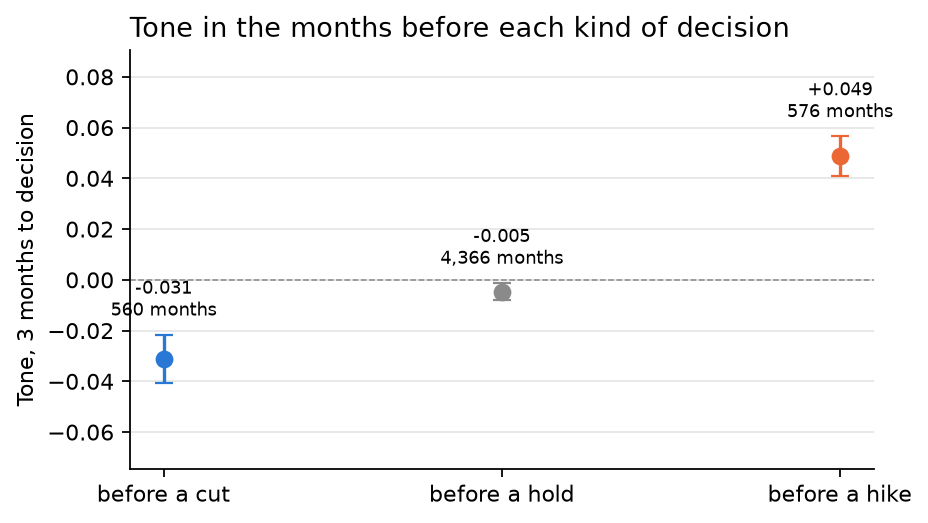
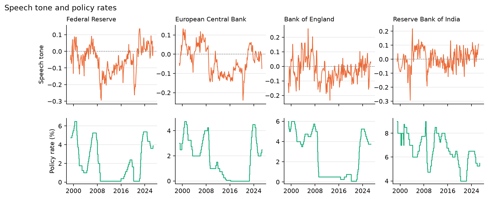

# Findings

Generated from `outputs/results.json` by `cbtone analyze`. Do not edit by hand: re-run the pipeline instead.

**Data:** 20,744 English speeches by central bankers from 79 central banks, 1996-09-10 to 2026-10-23: 20,690 from the BIS archive (to 2026-06-22) and 54 from five banks' live feeds since. 671,603 sentences about policy, prices, rates or the economy were scored. Rate decisions are tested for 21 central banks.

## Q1. How well can a cheap model read central bank tone?

Measured against people: the 496 human-labeled Federal Reserve sentences of the Trillion Dollar Words test file, which no model or prompt was tuned on.

| Labeler | Accuracy | Macro F1 | Weighted F1 |
|---|---|---|---|
| Language model (DeepSeek V4.1 Flash), zero-shot | 65.3% | 0.64 | 0.65 |
| Local scorer (bge-small embeddings + logistic regression) | 59.3% | 0.58 | 0.60 |

For scale, a published benchmark on the same task reports an F1 score of 0.58 for zero-shot ChatGPT-3.5 and 0.70 for a fine-tuned RoBERTa-large. The language model sits between the two; the local scorer, which runs free on a laptop CPU, gives up 6.0 points of accuracy to it.

**Outside the Fed.** No people labeled sentences from other banks, so two language models from different families labeled the same 150 sentences from 20 other central banks: deepseek-v4.1-flash-marathon and glm-5.3-marathon agreed 88.7% of the time (Cohen's kappa 0.82). On the 133 sentences where they agreed, the local scorer matched their label 74.4% of the time. This measures agreement, not accuracy.

## Q2. Tone moves with policy

A bank's tone over three months, against the change in its policy rate over the next three, across 5,481 bank-months: rank correlation **+0.20**. The relationship is positive at **19 of 21** banks (sign test p = 0.0002); strongest at Norges Bank +0.44, euro area (ECB) +0.37, Central Bank of Chile +0.35.
It is about zero at Bank Negara Malaysia (-0.00).
It is negative at People's Bank of China (-0.20).

| Next decision | Bank-months | Mean tone | 95% interval |
|---|---|---|---|
| cut | 560 | -0.031 | -0.041 to -0.022 |
| hold | 4,366 | -0.005 | -0.008 to -0.001 |
| hike | 576 | +0.049 | +0.041 to +0.057 |

**But tone mostly echoes the cycle.** Its correlation with the rate change of the *past* three months (+0.23) and with inflation (+0.25) is as strong as with the *coming* change (+0.20). Once the past change is accounted for, what is left for the coming one is +0.09.

## Q3. Tone does not predict the next decision beyond rates and inflation

For each bank and month, next month's decision (hike, hold, cut). Trained on 1999-2016 (3,152 bank-months), model chosen on 2017-2019 (609), tested once on 2020 onward (1,197, of which 263 were moves). The model was chosen by validation log loss before the test results were read.

| Model | Features | Test log loss | Macro F1 | Moves called right |
|---|---|---|---|---|
| logistic | past rates and inflation | 0.591 | 0.39 | 9.1% |
| logistic | plus speech tone | 0.588 | 0.41 | 11.8% |
| boosted trees (chosen) | past rates and inflation | 0.524 | 0.45 | 18.6% |
| boosted trees (chosen) | plus speech tone | 0.539 | 0.44 | 15.6% |

Adding tone made the chosen model slightly worse (test log loss 0.524 to 0.539). The placebo test shuffles each bank's tone across months 100 times: shuffled tone did at least as well as real tone in a share of runs that gives **p = 0.94**. Real tone is no more useful than tone with its timing destroyed.

This fits Q2. Tone tracks the policy cycle, but so do a bank's own recent moves and the latest inflation figure, which the baseline already has. What speeches say about the coming months is, on this evidence, mostly already in those numbers.

## Limits

- **A model reads the tone, not people.** Its accuracy is measured above; single sentences are often misread, and the monthly averages smooth that out.
- **The answer key is the Fed's.** Other banks phrase policy differently; outside the Fed there is only agreement between models, on 150 sentences.
- **Every speaker counts the same.** A deputy governor's speech weighs as much as the governor's; the archive does not say who votes.
- **Not causal.** Speeches and decisions both respond to the economy.
- **Monthly decisions.** Two moves in one month count as one; an emergency cut and a scheduled one look alike.

## Sources

- [BIS central bankers' speeches](https://www.bis.org/cbspeeches/download.htm) (non-commercial use)
- [BIS central bank policy rates](https://www.bis.org/statistics/dataportal/cbpol.htm)
- [BIS consumer prices](https://data.bis.org/static/bulk/WS_LONG_CPI_csv_flat.zip)
- Shah, Paturi and Chava (2023), [Trillion Dollar Words](https://arxiv.org/abs/2305.07972), human-labeled FOMC sentences (CC BY-NC 4.0)
- Shah and Chava (2023), [Zero is Not Hero Yet](https://arxiv.org/abs/2305.16633), the benchmark figures quoted in Q1
- Feeds: [Federal Reserve](https://www.federalreserve.gov/feeds/speeches.xml), [ECB](https://www.ecb.europa.eu/rss/press.html), [Bank of England](https://www.bankofengland.co.uk/rss/speeches), [Bank of Canada](https://www.bankofcanada.ca/content_type/speeches/feed/), [Reserve Bank of Australia](https://www.rba.gov.au/rss/rss-cb-speeches.xml)
